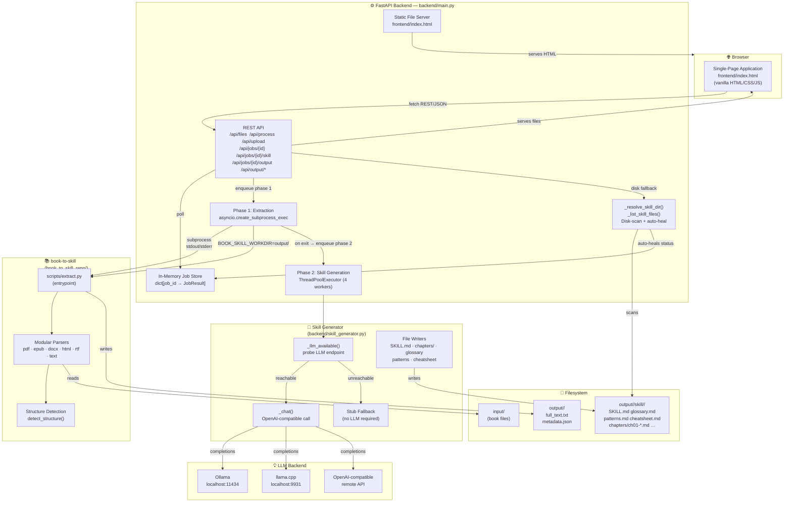

# Architecture

## System Overview



---

## Two-Phase Processing Pipeline

```
User selects file + options (generate_skill: true/false)
         │
         ▼
POST /api/process { file_path, mode, skill_name, generate_skill }
         │
         ▼
FastAPI creates job_id, stores {
  status: "pending",
  skill_status: null
}
         │
         ▼
─────────────────────────────────────────────
PHASE 1 — EXTRACTION (asyncio subprocess)
─────────────────────────────────────────────
  background task sets BOOK_SKILL_WORKDIR=output/<job_id>/
  asyncio.create_subprocess_exec(extract.py …)
         │
         ├─ stdout → job["stdout"]
         ├─ stderr → job["stderr"]
         └─ on exit (rc=0):
              parse output/<job_id>/metadata.json
              read  output/<job_id>/full_text.txt
              job["metadata"] / ["extracted_text"] populated
              job["status"] = "done"
         │
         ▼
─────────────────────────────────────────────
PHASE 2 — SKILL GENERATION (thread pool)
─────────────────────────────────────────────
  (only if generate_skill=True and extraction succeeded)
  job["skill_status"] = "running"

  loop.run_in_executor(thread_pool, generate_skill, …)
         │
         ├─ probe LLM endpoint (8 s timeout)
         │    reachable  → use _chat() for each artifact
         │    unreachable → use stub generators
         │
         ├─ generate per-chapter summaries  → chapters/ch01-*.md …
         ├─ generate glossary               → glossary.md
         ├─ generate patterns               → patterns.md
         ├─ generate cheatsheet             → cheatsheet.md
         └─ generate master SKILL.md        → SKILL.md
              job["skill_status"] = "done" | "error"
              job["skill_result"] = {
                skill_name, skill_dir, files[], chapters,
                generated_at, llm_available, error
              }
         │
         ▼
Frontend polls GET /api/jobs/{id} every 1.5 s
 status == "done" → populate Results tab, switch tab
 skill_status == "running" → keep polling + refresh skill files card live
 skill_status == "done" → render "Generated Skill Files" card
         │
         ▼
GET /api/jobs/{id}/skill
 ├─ _resolve_skill_dir():
 │    1. skill_result["skill_dir"] if set and exists on disk  (normal path)
 │    2. scan output/<job_id>/skill/*/  for first subdir      (server-restart fallback)
 ├─ auto-heal: skill_status "running" → "done" if .md files found on disk
 ├─ synthesise skill_result from disk when skill_result was null
 │    (llm_available = null  →  UI shows "🔍 recovered from disk")
 └─ return { skill_status, skill_result, files[] }

GET /api/jobs/{id}/skill/download/…  → serve individual .md files
 └─ also uses _resolve_skill_dir() — works without skill_result in memory
```

---

## Component Responsibilities

### `backend/main.py`
- FastAPI application serving both the REST API (`/api/*`) and the static frontend
- `/api/process` creates a UUID job and schedules phase-1 extraction as an asyncio background task
- `/api/upload` accepts multipart book-file uploads, saves to `input/`, and enforces `UPLOAD_MAX_MB`
- Phase-1 background task runs `scripts/extract.py` via `asyncio.create_subprocess_exec` (non-blocking)
  with `BOOK_SKILL_WORKDIR=output/<job_id>/` so all extraction output lands in a per-job directory
- On extraction success, phase 2 is dispatched to a `ThreadPoolExecutor(max_workers=4)` via
  `loop.run_in_executor` so LLM I/O does not block the event loop
- `/api/jobs/{id}` is polled by the frontend every 1.5 s until `status` + `skill_status` are settled
- `/api/jobs/{id}/skill` returns skill generation status and a list of generated `.md` files;
  uses **`_resolve_skill_dir()`** (disk-scan fallback) and **`_list_skill_files()`** helpers so
  files are visible even after a server restart (when `skill_result` was never persisted).
  Auto-heals `skill_status` from `"running"` → `"done"` when files are found on disk.
  Synthesises a minimal `skill_result` from disk metadata when the original is null
  (`llm_available = null` → UI badge shows "🔍 recovered from disk").
- `/api/jobs/{id}/skill/download/{file_path}` serves individual skill files with path-traversal
  protection; also uses `_resolve_skill_dir()` so downloads work without a persisted `skill_result`
- `/api/jobs/{id}/output` returns extracted text + parsed metadata for a completed job
- Path validation (`_safe_path`) restricts file access to `input/`, `output/`, and the user's home directory

### `backend/skill_generator.py`
- Reads `full_text.txt` and `metadata.json` from the job's output directory
- Detects chapter boundaries with `_find_chapter_offsets()` (regex on heading lines)
- Calls `_chat()` (OpenAI-compatible) for each artifact: per-chapter summaries, glossary, patterns,
  cheatsheet, and the master `SKILL.md`
- `_llm_available()` probes the endpoint before any generation attempt; if it times out or errors,
  `generate_skill()` falls back to stub generators that produce valid-but-minimal placeholder files
- All output is written to `output/<job_id>/skill/<skill_name>/`
- Returns a `SkillGenerationResult` dataclass that serialises cleanly to JSON for the API

### `frontend/index.html`
- Fully self-contained single-page application — zero build tools, zero npm
- Five interaction panels: *Process*, *Upload*, *Results*, *History*, *Dependencies*
- **Process tab**: file browser (navigable), extraction-mode dropdown, skill-name input,
  "Generate skill (LLM)" toggle
- **Upload tab**: drag-and-drop / click-to-browse file upload zone; files land in `input/`
  and are immediately available in the file browser
- **Results tab**: extracted text preview (first 8 000 chars), metadata JSON,
  downloadable raw artefacts, **Generated Skill Files** card with per-file download links
  grouped by type (top-level vs `chapters/`).
  The card is always shown when a job is done — even if `skill_result` was null at load time.
- Polls `/api/jobs/{id}` while job is running; continues polling while `skill_status === "running"`,
  refreshing the skill files card on every tick so partial results appear live
- History tab: click any past job to restore it as the active job and refresh skill files.
  **`viewSkill()`** triggers `populateResults()` which always calls `refreshSkillFiles()`.
- Download URLs for chapter files use per-segment encoding
  (`rel_path.split('/').map(encodeURIComponent).join('/')`) so path separators are preserved

### `scripts/extract.py` (book-to-skill library)
- Detects the input format and routes to the appropriate parser
- Reads `BOOK_SKILL_WORKDIR` env var to determine where to write `full_text.txt` and `metadata.json`
- Accepts `--mode text|technical` for extraction strategy

---

## Security Notes

- Path traversal is prevented by `_safe_path()`: resolved paths must be inside
  `input/`, `output/`, or `$HOME`.
- Skill file download (`/api/jobs/{id}/skill/download/{file_path}`) additionally verifies
  the requested file resolves inside the specific job's skill directory.
- No credentials are stored or transmitted to the client; LLM API keys live only in `.env` on the server.
- The server binds to `0.0.0.0` by default — restrict to `127.0.0.1` in `.env`
  for local-only deployments.
- The `book-to-skill` library never uploads files; all processing is local.

---

## Output Directory Layout

```
output/
└── <job_id>/                        ← UUID per processing job
    ├── full_text.txt                ← complete extracted book text
    ├── metadata.json                ← document metadata (pages, words, chapters …)
    └── skill/
        └── <skill_name>/            ← slug derived from skill-name input
            ├── SKILL.md             ← master skill index + core frameworks
            ├── glossary.md          ← alphabetical key-term definitions
            ├── patterns.md          ← techniques & design patterns
            ├── cheatsheet.md        ← decision rules & quick-reference tables
            └── chapters/
                ├── ch01-<slug>.md   ← per-chapter summary
                ├── ch02-<slug>.md
                └── ...
```
