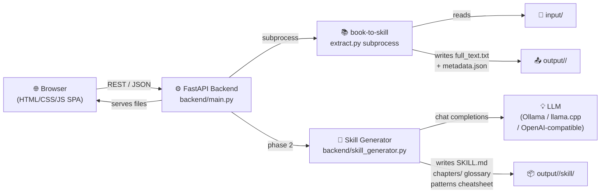

# Book-to-Skill Web UI

> A full-stack web application that wraps the [book-to-skill](https://github.com/virgiliojr94/book-to-skill) library in an interactive browser-based interface.  
> Drop in a book file, click **▶ Process**, and receive a complete structured AI-agent skill package (SKILL.md, chapters, glossary, patterns, cheatsheet) — optionally generated by a local or remote LLM.

[](LICENSE)
[](https://python.org)

---

## Overview

This application lets you:

1. **Browse** your `input/` folder (or any directory) for supported book files
2. **Configure** the extraction mode (text vs. technical/docling)
3. **Process** files through the `book-to-skill` library with live progress feedback
4. **Generate** a structured AI-agent skill package from the extracted text (via an OpenAI-compatible LLM)
5. **Inspect** extracted text, document metadata, and all generated skill files
6. **Download** output artefacts directly from the browser

Supported input formats: PDF · EPUB · DOCX · HTML · RTF · MOBI/AZW · TXT · Markdown · RST · AsciiDoc

---

## Architecture



See [Docs/Architecture.md](Docs/Architecture.md) for the detailed two-phase data-flow diagram.

---

## Quickstart

See [Docs/Quickstart.md](Docs/Quickstart.md) for detailed instructions including LLM configuration.

**TL;DR:**

```bash
# 1. Clone this repo
git clone <this-repo>
cd book-to-skill-test

# 2. Copy env config (edit LLM_BASE_URL / LLM_MODEL if needed)
cp .env.example .env

# 3. Place a book file in input/  — or use the bundled sample:
#    input/sample/introduction-to-python.txt  (ready to use, no extra steps)
cp ~/mybook.pdf input/

# 4. Start the application (installs deps + clones book-to-skill automatically)
./scripts/start.sh

# 5. Open your browser
open http://localhost:8080
```

---

## Project Structure

```
book-to-skill-test/
├── backend/
│   ├── main.py              # FastAPI application — extraction + skill wiring
│   └── skill_generator.py   # LLM-powered skill package generator
├── frontend/
│   └── index.html           # Single-page UI (vanilla JS, no build step)
├── input/                   # Place book files here (synced, contents ignored)
│   └── sample/
│       └── introduction-to-python.txt  # Bundled sample file for quick testing
├── output/                  # Per-job artefacts (synced, contents ignored)
│   └── <job_id>/
│       ├── full_text.txt    # Extracted book text
│       ├── metadata.json    # Document metadata
│       └── skill/<name>/    # Generated skill package
│           ├── SKILL.md
│           ├── glossary.md
│           ├── patterns.md
│           ├── cheatsheet.md
│           └── chapters/
│               ├── ch01-*.md
│               └── ...
├── scripts/
│   ├── start.sh             # Start server in background
│   ├── stop.sh              # Graceful shutdown
│   └── cleanup.sh           # Remove build artefacts
├── tests/
│   └── test_api.py          # 51 pytest tests (API + skill generator + LLM status)
├── Docs/
│   ├── Quickstart.md        # Detailed setup + LLM configuration guide
│   └── Architecture.md      # Two-phase pipeline diagram & design notes
├── pyproject.toml           # pytest config (asyncio strict mode, markers)
├── requirements.txt         # Python dependencies
├── .env.example             # Environment variable template
└── README.md
```

---

## API Reference

| Method | Endpoint | Description |
|--------|----------|-------------|
| `GET` | `/api/health` | Health check |
| `GET` | `/api/llm/status` | Probe LLM availability — returns `available`, `model`, `base_url`, `checked_at` |
| `GET` | `/api/files?directory=…` | List supported files in a directory |
| `GET` | `/api/directories?directory=…` | List subdirectories for navigation |
| `POST` | `/api/process` | Start an extraction + skill-generation job |
| `GET` | `/api/jobs/{id}` | Poll a job's status and extraction output |
| `GET` | `/api/jobs` | List all jobs |
| `DELETE` | `/api/jobs/{id}` | Remove a job |
| `GET` | `/api/jobs/{id}/skill` | Skill generation status + list of generated `.md` files (disk-scan fallback + auto-heal) |
| `GET` | `/api/jobs/{id}/skill/download/{file_path}` | Download a generated skill file (works without `skill_result`) |
| `GET` | `/api/jobs/{id}/output` | Raw extracted text + metadata for a completed job |
| `POST` | `/api/upload` | Upload a book file to `input/` (size-limited by `UPLOAD_MAX_MB`) |
| `GET` | `/api/output/files` | List raw output artefacts |
| `GET` | `/api/output/download/{job_id}/{file}` | Download a file from a per-job output directory |
| `GET` | `/api/output/download/{file}` | Download a file from the top-level output directory |
| `GET` | `/api/dependencies` | Run `book-to-skill --check` |
| `GET` | `/docs` | Interactive Swagger UI |

---

## Environment Variables

Key settings in `.env` (copy from `.env.example`):

```bash
APP_HOST=0.0.0.0          # bind address (use 127.0.0.1 for local-only)
APP_PORT=8080              # server port
UPLOAD_MAX_MB=100          # max upload size in MB (0 = unlimited)
SKILLS_DIR=~/.agents/skills  # where generated skills are also copied (optional)

LLM_BASE_URL=http://localhost:11434/v1   # LLM endpoint
LLM_API_KEY=ollama                       # API key (any string for Ollama)
LLM_MODEL=llama3.2:latest                # exact model tag (run: ollama list)
LLM_TIMEOUT=120                          # seconds per LLM request
```

## LLM Configuration

Skill generation uses any **OpenAI-compatible** endpoint. Set in `.env`:

```bash
# Local Ollama (default)
# Run `ollama list` to confirm the exact model tag installed on your machine.
# "llama3" (no suffix) is a legacy alias removed in newer Ollama releases.
LLM_BASE_URL=http://localhost:11434/v1
LLM_MODEL=llama3.2:latest
LLM_API_KEY=ollama

# Local llama.cpp
LLM_BASE_URL=http://localhost:9931/v1
LLM_MODEL=your-model-name
LLM_API_KEY=none

# Remote OpenAI
LLM_BASE_URL=https://api.openai.com/v1
LLM_MODEL=gpt-4o-mini
LLM_API_KEY=sk-...
```

If no LLM is reachable the skill generator degrades gracefully — it writes **stub** skill files so the rest of the pipeline still completes successfully.

> **Troubleshooting Ollama detection:** if the UI shows "stub (LLM offline)" even though Ollama is running,
> the most common cause is a model name mismatch.  Run `ollama list` and update `LLM_MODEL` in `.env`
> to exactly match an entry in that list (e.g. `llama3.2:latest`, not `llama3`).

---

## License

MIT — see [LICENSE](LICENSE).  
This application is an independent wrapper; it does not ship any book content.  
The `book-to-skill` library is © Virgilio Junior, MIT License.
